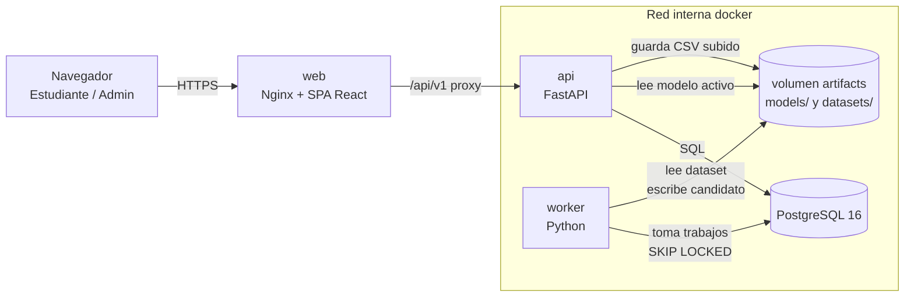
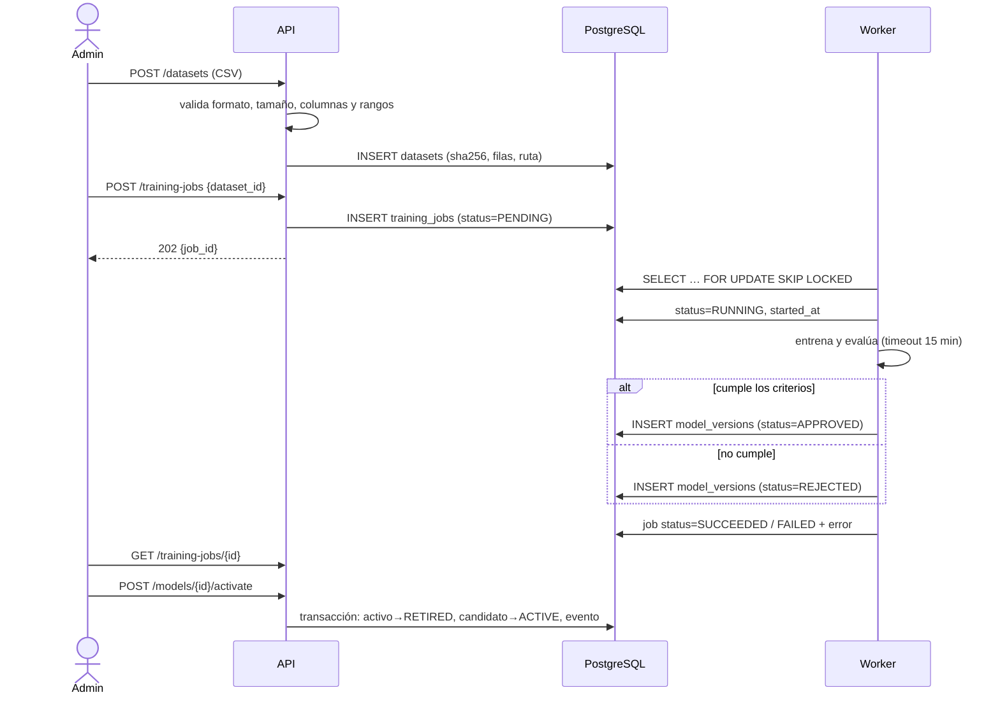
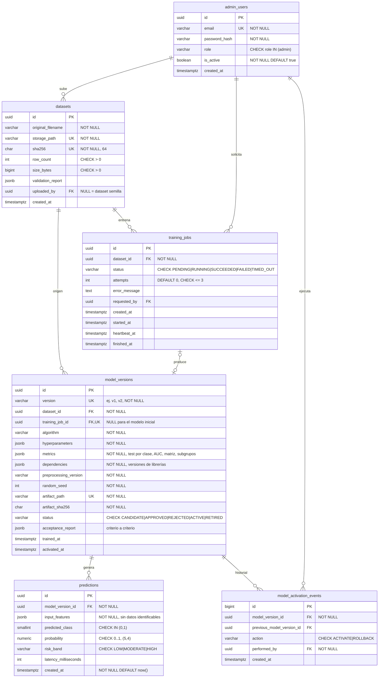
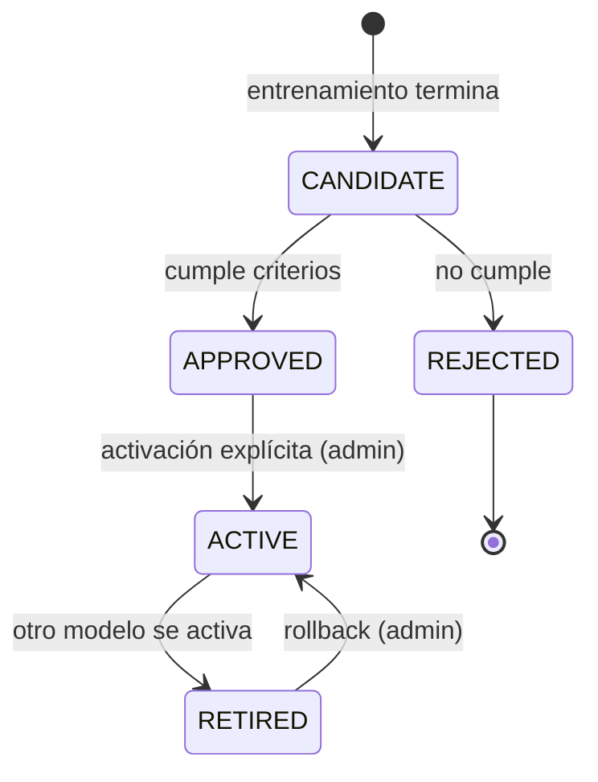
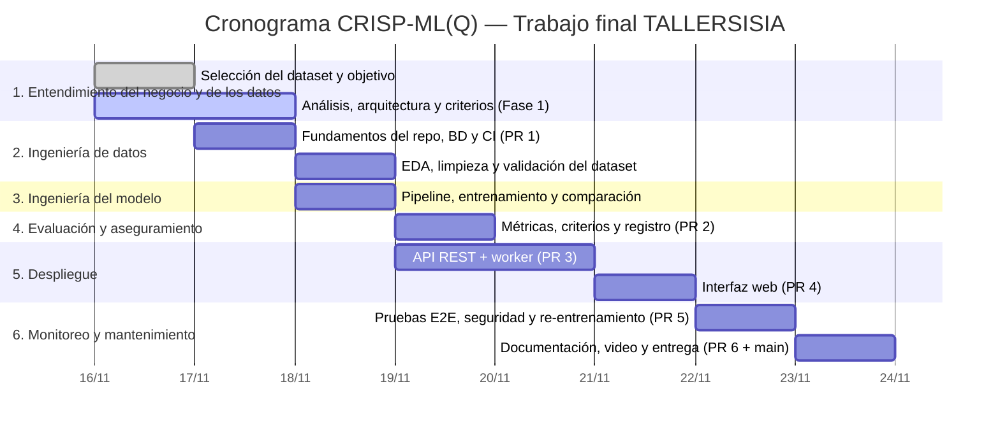

# Análisis y diseño arquitectónico — Fases 0 y 1

**Proyecto:** Sistema de estimación de riesgo de depresión en estudiantes
**Materia:** TALLERSISIA · Semestre 2-2026
**Estado:** Propuesta pendiente de aprobación
**Periodo del cronograma:** 16 al 23 de noviembre de 2026

> Aviso ético. El sistema estima un *riesgo estadístico* a partir de hábitos y contexto académico. **No es un diagnóstico clínico.** Toda respuesta de la API y de la UI dirigida al usuario incluye ese aviso y una invitación a buscar apoyo profesional.

---

## 1. Análisis de la idea y de los requisitos de la materia

### 1.1 Problema
La depresión en estudiantes universitarios es frecuente y suele detectarse tarde. Con un formulario breve sobre presión académica, sueño, alimentación, estrés financiero, horas de estudio y antecedentes familiares, un modelo supervisado puede estimar la probabilidad de que el perfil se parezca al de estudiantes que reportaron depresión. Esa estimación sirve como herramienta de **concientización y orientación**, no de diagnóstico.

### 1.2 Tipo de aplicación de IA
**Clasificación binaria supervisada.** Objetivo: `Depression` (0/1). La salida es una clase (riesgo bajo o alto) más una probabilidad calibrada, que la UI muestra en tres bandas (bajo < 0,40 ≤ moderado < 0,70 ≤ alto).

### 1.3 Mapeo de los requisitos de la materia

| Requisito de la materia | Cómo se cubre |
|---|---|
| Dataset nuevo para aprendizaje supervisado | Student Depression Dataset (27 901 filas), ver `CLAUDE.md` |
| Organizar el entrenamiento con CRISP-ML(Q) y un cronograma | Sección 11 de este documento y `docs/ml-lifecycle.md` (Fase 7) |
| Modelo entrenado con métricas aceptables | Criterios de aceptación definidos antes de entrenar (sección 10.3) |
| API: predecir | `POST /api/v1/predictions` |
| API: historial (datos enviados y resultado) | `GET /api/v1/predictions` (paginado, solo admin) |
| API: métricas de rendimiento | `GET /api/v1/models/active` y `GET /api/v1/models` |
| API: re-entrenar con datos actualizados | `POST /api/v1/training-jobs` (asíncrono) y `GET /api/v1/training-jobs/{id}` |
| API: enviar el archivo de entrenamiento | `POST /api/v1/datasets` (multipart, validado y versionado) |
| UI que consulte todos los endpoints | SPA React con 6 pantallas (sección 5.2) |
| Diagrama de BD y script | Mermaid (sección 9) + SQL offline de Alembic en `docs/sql/` |
| Documento Swagger | OpenAPI generado por FastAPI y exportado a `docs/openapi.json` |
| Video de 5 minutos | Guion en `docs/guion-video.md` (Fase 7) |
| Documento CRISP-ML(Q) y desarrollo | Documento final en Word (entregado aparte) |
| Repositorio GitHub público y PR revisados por IA | Flujo `feature/*` → `dev` → `main`, 6 PR + 1 final |

### 1.4 Usuarios
- **Estudiante / visitante (anónimo):** completa el formulario y ve su nivel de riesgo, su probabilidad y recursos de ayuda.
- **Administrador (docente / equipo del proyecto):** consulta el historial, sube datasets, lanza re-entrenamientos, compara candidatos y activa o revierte modelos.

### 1.5 Fuera de alcance (YAGNI)
Multi-tenancy, registro de estudiantes, notificaciones, explicabilidad por predicción (SHAP), monitoreo de drift automatizado (queda documentado como mejora futura) y despliegue en la nube (opcional, con Dokploy si el tiempo alcanza).

---

## 2. Requisitos funcionales y no funcionales

### 2.1 Funcionales
| ID | Requisito | Actor |
|---|---|---|
| RF-01 | Enviar las respuestas del formulario y recibir la clase, la probabilidad, la banda de riesgo, la versión del modelo y el aviso ético | Anónimo |
| RF-02 | Validar la entrada (tipos, rangos y categorías permitidas) con errores claros | Sistema |
| RF-03 | Guardar cada predicción con la entrada, el resultado, la probabilidad, la versión del modelo y la fecha | Sistema |
| RF-04 | Consultar el historial paginado y filtrable por versión del modelo y por fecha | Admin |
| RF-05 | Consultar las métricas del modelo activo (por clase, ROC-AUC y matriz de confusión) | Anónimo |
| RF-06 | Listar todas las versiones con su estado y sus métricas | Admin |
| RF-07 | Subir un CSV de entrenamiento, validado en formato, tamaño y columnas, y guardado versionado con su hash | Admin |
| RF-08 | Lanzar un re-entrenamiento asíncrono sobre un dataset subido y recibir el id del trabajo | Admin |
| RF-09 | Consultar el estado de un trabajo (pendiente, en ejecución, terminado, fallido, vencido por timeout) | Admin |
| RF-10 | Activar explícitamente un candidato aprobado | Admin |
| RF-11 | Hacer rollback a la versión activa anterior | Admin |
| RF-12 | Iniciar sesión como administrador | Admin |
| RF-13 | Healthcheck de la API (liveness) y de la BD y el modelo cargado (readiness) | Infra |

### 2.2 No funcionales
| ID | Atributo | Requisito |
|---|---|---|
| RNF-01 | Seguridad | JWT firmado (HS256) con `iss`, `aud`, `exp` de 60 min y contraseña con hash Argon2. Rutas de administración protegidas en el backend |
| RNF-02 | Privacidad | Sin datos identificables: no se guardan nombre, ciudad, IP ni la pregunta de pensamientos suicidas. El historial solo es visible para el admin |
| RNF-03 | Rendimiento | Inferencia (percentil 95) < 100 ms, con el modelo en memoria y recargado cuando cambia la activación |
| RNF-04 | Disponibilidad del modelo | Un re-entrenamiento fallido nunca altera el modelo activo |
| RNF-05 | Trazabilidad | Cada predicción enlaza con `model_version_id`. Cada modelo enlaza con su dataset (hash) y su trabajo de entrenamiento |
| RNF-06 | Reproducibilidad | Semilla fija, dependencias fijadas y hash de dataset y de artefacto |
| RNF-07 | Mantenibilidad | Capas presentación / aplicación / dominio / infraestructura. Lint con ruff, tipos con mypy (strict) y tsc |
| RNF-08 | Portabilidad | `docker compose up` levanta todo. Imágenes con versión fija |
| RNF-09 | Observabilidad | Logs JSON con `request_id`, latencia de inferencia y versión activa, sin datos sensibles |
| RNF-10 | Accesibilidad / UX | Responsive, contraste AA, navegable con teclado y textos en español |
| RNF-11 | Calidad | CI con lint, tipos y tests en cada PR. Tests de integración contra PostgreSQL real |

---

## 3. Arquitectura propuesta

### 3.1 Decisión: **monolito modular + worker separado (híbrida ligera)**
- **Un solo backend en Python** con módulos por dominio. Entrenamiento e inferencia comparten el mismo código de preprocesamiento (DRY y sin *training/serving skew*).
- **Dos procesos del mismo código:** `api` (FastAPI/uvicorn) y `worker` (bucle que toma trabajos de la tabla `training_jobs`). Así un entrenamiento pesado no bloquea las peticiones HTTP y, si el worker se cae, la API sigue sirviendo el modelo activo.
- **Cola en PostgreSQL** con `SELECT … FOR UPDATE SKIP LOCKED`. No se añaden Redis ni Celery: el volumen esperado es de unos pocos trabajos al día, y una tabla ya da trazabilidad, estados e idempotencia (sección 7 de la base: no introducir componentes por tendencia).
- **SPA estática** (React) servida por Nginx, que habla con la API vía `/api` (proxy inverso, mismo origen y CORS mínimo).

Se descartan los microservicios (un servicio de inferencia y otro de entrenamiento independientes): duplicarían la configuración, los contratos y el despliegue sin beneficio real para el alcance.

### 3.2 Diagrama



### 3.3 Flujo de re-entrenamiento



---

## 4. Stack tecnológico justificado

| Capa | Elección | Justificación |
|---|---|---|
| Lenguaje backend/ML | **Python 3.12** | Ecosistema ML estándar. Se usa 3.12 y no 3.14 (la del equipo local) por compatibilidad garantizada de las ruedas de scikit-learn y psycopg y de la imagen `python:3.12-slim` |
| Gestión de dependencias | **uv** + `pyproject.toml` + `uv.lock` | Bloqueo reproducible y rápido. Cubre la sección 6.3 (registrar dependencias) |
| ML | **scikit-learn 1.5**, pandas, numpy, joblib | `Pipeline` + `ColumnTransformer` evitan el leakage. Modelos tabulares adecuados al tamaño del dataset. Serialización estándar |
| API | **FastAPI** + Pydantic v2 | Validación declarativa, OpenAPI/Swagger automático (entregable) y async |
| ORM / migraciones | **SQLAlchemy 2.0** + **Alembic** | Migraciones versionadas y exportables a SQL offline (entregable "script de BD") |
| Driver | psycopg 3 | Mantenido y con soporte de `SKIP LOCKED` |
| BD | **PostgreSQL 16** | Relacional con integridad, CHECK, JSONB para la entrada de la predicción e índices parciales |
| Auth | PyJWT + argon2-cffi | JWT con validación completa y hash de contraseña recomendado por OWASP |
| Logs | structlog (JSON) | Logs estructurados con `request_id` |
| Calidad backend | ruff, mypy, pytest, httpx, pytest-cov | Lint, tipos y tests. Integración con un PostgreSQL real (servicio en CI) |
| Frontend | **React 18 + Vite + TypeScript** | Requisito del kit. Build rápido y tipado |
| Datos en el cliente | TanStack Query + cliente fetch centralizado | Estados de carga, error y éxito uniformes, caché y polling del trabajo |
| Tipos del contrato | **openapi-typescript** | Tipos generados desde `openapi.json`, sincronizados con el backend |
| UI | Tailwind CSS + componentes propios accesibles, Recharts | Diseño moderno y consistente, y gráficos de métricas y matriz de confusión |
| Formularios | react-hook-form + zod | Validación en el cliente para la UX. El backend sigue siendo la autoridad |
| Tests frontend / E2E | Vitest + Testing Library, **Playwright** | Pruebas unitarias de componentes y flujo completo en el navegador |
| Contenedores | Docker Compose (`postgres:16.4-alpine`, `python:3.12-slim`, `node:22-alpine`, `nginx:1.27-alpine`) | Entorno reproducible y versiones fijas, nunca `latest` |
| CI | GitHub Actions | Lint, tipos y tests en cada PR hacia `dev` y `main` |
| Revisión de PR por IA | CodeRabbit o GitHub Copilot review (gratis para repos públicos / estudiantes) | Evidencia "plus" de la materia |

---

## 5. Módulos, servicios y responsabilidades

### 5.1 Backend (`backend/src/app/modules/`)
| Módulo | Dominio | Aplicación (casos de uso) | Infraestructura | Presentación |
|---|---|---|---|---|
| `prediction` | `StudentProfile` (value object validado), `RiskBand` | `PredictRisk`, `ListPredictions` | `PredictionRepository` (SQLAlchemy) | `/predictions` |
| `models` (registro) | `ModelVersion`, `ModelStatus` y transiciones válidas, `AcceptanceCriteria` | `GetActiveModel`, `ListModels`, `ActivateModel`, `RollbackModel` | `ModelVersionRepository`, `ArtifactStore` (sistema de archivos), `ModelLoader` (caché en memoria) | `/models` |
| `datasets` | `DatasetSchema` (columnas, tipos, rangos y categorías) | `UploadDataset` | `DatasetRepository`, `FileStorage` | `/datasets` |
| `training` | `TrainingJob`, `JobStatus` | `EnqueueTraining`, `GetJob`, `RunTrainingJob` (worker) | `JobRepository` (SKIP LOCKED) | `/training-jobs` |
| `auth` | `AdminUser`, `Role` | `Login` | `UserRepository`, `PasswordHasher`, `TokenService` | `/auth/login` y dependencia `require_admin` |
| `health` | — | — | ping a la BD y comprobación del modelo cargado | `/health/live`, `/health/ready` |

**Paquete `ml/`** (biblioteca interna y pura, sin FastAPI ni BD): `schema.py` (contrato de columnas compartido por el entrenamiento y la API), `cleaning.py`, `features.py` (ColumnTransformer), `train.py`, `evaluate.py`, `registry_metadata.py`. Lo usan el CLI de entrenamiento inicial, el worker y la inferencia, de modo que el preprocesamiento es único.

**`shared/`**: configuración (pydantic-settings, fail fast), sesión de BD y unidad de trabajo, errores de dominio → formato de error único (`{"error": {"code", "message", "details", "request_id"}}`), logging y middleware de `request_id`.

### 5.2 Frontend (`frontend/src/features/`)
| Feature | Endpoints | Acceso |
|---|---|---|
| `assessment` (formulario y resultado) | `POST /predictions`, `GET /models/active` | Público |
| `metrics` (panel con gráficos) | `GET /models/active`, `GET /models` | Público (activo) / Admin (todas) |
| `auth` (login) | `POST /auth/login` | Público |
| `history` (tabla paginada) | `GET /predictions` | Admin |
| `datasets` (subida) | `POST /datasets`, `GET /datasets` | Admin |
| `training` (lanzar, seguir, comparar, activar y rollback) | `POST/GET /training-jobs`, `POST /models/{id}/activate`, `POST /models/rollback` | Admin |

Comunes: `api/client.ts` (único punto de fetch, adjunta el JWT guardado en memoria/sessionStorage y normaliza los errores), `api/schema.d.ts` (generado), `components/ui/*` y `RequireAdmin` (solo navegación; la autorización real está en el backend).

### 5.3 Contrato de endpoints (borrador)
| Método | Ruta | Acceso | Respuesta |
|---|---|---|---|
| POST | `/api/v1/auth/login` | Público (con rate limit) | `{access_token, expires_in}` |
| POST | `/api/v1/predictions` | Público (con rate limit) | `201 {id, prediction, probability, risk_band, model_version, disclaimer, created_at}` |
| GET | `/api/v1/predictions?page&size&model_version_id&from&to` | Admin | página |
| GET | `/api/v1/models/active` | Público | versión y métricas |
| GET | `/api/v1/models` | Admin | lista de versiones |
| GET | `/api/v1/models/{id}` | Admin | detalle |
| POST | `/api/v1/models/{id}/activate` | Admin | versión activada |
| POST | `/api/v1/models/rollback` | Admin | versión restaurada |
| POST | `/api/v1/datasets` | Admin | `201 {id, sha256, rows, …}` |
| GET | `/api/v1/datasets` | Admin | lista |
| POST | `/api/v1/training-jobs` | Admin | `202 {job_id, status}` |
| GET | `/api/v1/training-jobs/{id}` | Admin | estado, error y candidato |
| GET | `/api/v1/health/live`, `/health/ready` | Público | estado |

---

## 6. Estructura del repositorio

```text
.
├── .github/workflows/ci.yml
├── backend/
│   ├── pyproject.toml · uv.lock · Dockerfile · alembic.ini
│   ├── migrations/            # Alembic (versions/)
│   ├── src/app/
│   │   ├── main.py            # FastAPI app factory
│   │   ├── worker.py          # entrypoint del worker
│   │   ├── config/            # settings (fail fast)
│   │   ├── shared/            # db, errores, logging, seguridad
│   │   ├── ml/                # schema, cleaning, features, train, evaluate
│   │   └── modules/
│   │       ├── auth/ prediction/ models/ datasets/ training/ health/
│   │       │   └── domain/ application/ infrastructure/ presentation/   (solo las capas necesarias)
│   ├── scripts/               # train_initial.py, seed_admin.py, export_openapi.py
│   └── tests/ unit/ integration/ contract/ ml/
├── frontend/
│   ├── package.json · vite.config.ts · Dockerfile · nginx.conf
│   ├── src/ api/ components/ features/ routes/ styles/
│   └── e2e/                   # Playwright
├── data/raw/student_depression_dataset.csv
├── notebooks/ 01-eda.ipynb    # EDA reproducible (Fase 3)
├── docs/                      # base, análisis, arquitectura, api, openapi.json, sql/, figuras/
├── docker-compose.yml · .env.example · .gitignore
├── README.md · AGENTS.md · CLAUDE.md
```
Los artefactos de modelos y los datasets subidos viven en el volumen `artifacts` (fuera de git). El modelo inicial se genera con `scripts/train_initial.py` al primer arranque.

---

## 7. Riesgos, dependencias y decisiones pendientes

### 7.1 Autenticación y autorización (propuesta)
- **Un rol `admin`**. Usuario inicial creado por `seed_admin.py` desde `ADMIN_EMAIL` y `ADMIN_PASSWORD` en `.env`, con la contraseña guardada como hash Argon2. Sin registro público (YAGNI).
- **JWT HS256** con secreto ≥ 32 bytes en `.env`, `exp` de 60 min, y `iss`/`aud` validados. Sin refresh token: al expirar se vuelve a iniciar sesión (KISS, y no hay que proteger un mecanismo de renovación).
- **Públicos:** predicción, métricas del modelo activo, health y login. **Admin:** historial, lista de modelos, datasets, entrenamiento, activación y rollback.
- **Historial restringido: SÍ.** Son respuestas sobre salud mental. Aunque no se guardan identificadores, combinar edad, género, CGPA y fecha podría reidentificar a alguien en un grupo pequeño. Se guarda en `JSONB` solo lo necesario para trazabilidad, sin IP ni user-agent. Retención propuesta: 180 días (documentada; la purga queda como script manual).
- **Rate limiting** en `/predictions` y `/auth/login` (middleware en memoria, suficiente para una sola instancia).

### 7.2 Riesgos
| Riesgo | Impacto | Mitigación |
|---|---|---|
| Uso del sistema como diagnóstico | Alto (ético) | Aviso obligatorio en la API y la UI, lenguaje de "riesgo estimado" y enlaces a líneas de ayuda |
| Fuga de la variable de pensamientos suicidas | Alto (ético y de leakage conceptual) | Se excluye del schema. Un test verifica que no está entre las features |
| Sesgo por género o edad | Medio | Métricas por subgrupo (género y tramos de edad) y criterio de brecha máxima |
| Dataset de origen dudoso (Kaggle, India, autoreporte) | Medio | Documentado en la model card. No se generaliza a otras poblaciones |
| CSV subido malicioso o enorme | Medio | Límite de 10 MB, solo `.csv`/`text/csv`, validación de schema antes de aceptar, nombre generado por el servidor |
| El worker se cuelga | Medio | Timeout de 15 min, heartbeat, y los trabajos `RUNNING` vencidos pasan a `TIMED_OUT` al reiniciar |
| Plazo muy corto | Alto | Plan por PR acotados, y el despliegue en la nube como opcional |
| Docker no está en el PATH de la terminal del agente | Bajo | Verificar `docker version` desde la terminal del usuario en la Fase 2 |

### 7.3 Dependencias externas
GitHub (repo público y Actions), Docker Desktop y la herramienta de revisión de PR por IA.

### 7.4 Decisiones pendientes (para el usuario)
1. Usuario/repositorio de GitHub.
2. Fecha de entrega exacta (ver sección 11).
3. Herramienta de revisión de PR por IA (CodeRabbit o Copilot).
4. Si se despliega públicamente (Dokploy u otro) o solo en local.

---

## 8. Plan de implementación por fases (ramas y PR)

| Fase | Rama | PR → `dev` | Contenido | Entregable |
|---|---|---|---|---|
| 0-1 | — (commit inicial en `main`) | — | CLAUDE.md, base y este análisis | Diseño aprobado |
| 2 | `feature/fundamentos` | **PR 1** | Estructura, compose con PostgreSQL, settings fail fast, SQLAlchemy + Alembic (migración 0001), CI, README y AGENTS | Repo ejecutable y CI verde |
| 3 | `feature/modelo-ml` | **PR 2** | EDA, limpieza, validación del dataset, Pipeline, comparación de modelos, evaluación, registro de versión y tests de ML | Modelo v1 aprobado |
| 4 | `feature/api` | **PR 3** | Endpoints, auth, worker, errores, logs, Swagger, compose y tests unitarios, de integración y de contrato | API completa + `openapi.json` |
| 5 | `feature/frontend` | **PR 4** | SPA con las 6 pantallas, cliente tipado y compose | UI completa |
| 6 | `feature/pruebas-e2e` | **PR 5** | Playwright, escenarios negativos, revisión de seguridad y regresiones | Informe de pruebas |
| 7-8 | `feature/documentacion` | **PR 6** | Documentación real, SQL offline, ERD, documento final y guion | Entregables |
| Cierre | `dev` → `main` | **PR final** | Release v1.0.0 | Repo público final |

---

## 9. Diseño de la base de datos



**Restricciones e índices clave**
- **Un único modelo activo:** índice único parcial `CREATE UNIQUE INDEX uq_one_active_model ON model_versions ((true)) WHERE status = 'ACTIVE'`.
- **Un único trabajo en ejecución** a la vez: índice único parcial sobre `training_jobs ((true)) WHERE status = 'RUNNING'`. Además, `POST /training-jobs` rechaza (409) si ya hay uno `PENDING` o `RUNNING` para el mismo dataset (idempotencia).
- `predictions (created_at DESC)` y `predictions (model_version_id, created_at DESC)` para el historial paginado y filtrado.
- `training_jobs (status, created_at)` para que el worker tome el siguiente trabajo.
- La activación y el rollback ocurren en **una sola transacción**: el activo pasa a `RETIRED`, el objetivo a `ACTIVE` y se inserta el evento.
- Las predicciones nunca se borran en cascada (`ON DELETE RESTRICT`) y los modelos nunca se eliminan: solo cambian de estado.

---

## 10. Ciclo de vida del modelo

### 10.1 Estados y transiciones


- Solo `APPROVED` o `RETIRED` pueden pasar a `ACTIVE`. Un `REJECTED` nunca se activa, y lo valida el dominio, no solo la UI.
- **Rollback:** reactiva el `previous_model_version_id` del último evento de activación.
- La API recarga el modelo activo cuando cambia su versión (la verifica en cada predicción con una consulta barata cacheada durante 5 s), así que no hace falta reiniciar.

### 10.2 Flujo CRISP-ML(Q) aplicado
Dataset → validación de schema → limpieza (`CLAUDE.md`) → split estratificado 70/15/15 con semilla 42 → Pipeline (imputación + escalado + one-hot/ordinal) → modelos → evaluación en validación → elección → evaluación final en test → criterios → registro → activación → monitoreo (latencia, distribución de la probabilidad y tasa de riesgo alto por versión).

**Modelos a comparar:** `DummyClassifier` (base), `LogisticRegression` (interpretable), `RandomForestClassifier` y `HistGradientBoostingClassifier`, con búsqueda acotada de hiperparámetros y validación cruzada estratificada de 5 pliegues sobre train.

### 10.3 Criterios de aceptación (definidos ANTES de entrenar)
Medidos en el conjunto de **test**, sin la variable de pensamientos suicidas:

| # | Criterio | Umbral | Justificación |
|---|---|---|---|
| C1 | ROC-AUC | ≥ 0,85 | Capacidad de discriminación sólida para tamizaje. Es alcanzable según la literatura del dataset aun sin la variable excluida (a validar en la Fase 3) |
| C2 | Recall de la clase 1 (riesgo) | ≥ 0,80 | En tamizaje, un falso negativo cuesta más que un falso positivo |
| C3 | Precisión de la clase 1 | ≥ 0,75 | Evita alarmar de más |
| C4 | F1 macro | ≥ 0,78 | Equilibrio entre ambas clases (no basta con una métrica global) |
| C5 | Mejora frente al Dummy | ROC-AUC del modelo − Dummy ≥ 0,25 | Demuestra que aprende algo real |
| C6 | Equidad por género | \|recall(M) − recall(F)\| ≤ 0,05 | Sesgo controlado |
| C7 | Generalización | \|AUC(validación) − AUC(test)\| ≤ 0,03 | Sin sobreajuste a la selección |
| C8 | Operativos | Inferencia (percentil 95) < 100 ms y artefacto < 50 MB | Viable en la API |
| C9 | Re-entrenamiento | El candidato no baja el ROC-AUC del activo en más de 0,01, medido sobre el mismo test de referencia | No degradar la producción |

Si C1–C3 no se alcanzan sin la variable excluida, **no se relaja el criterio en silencio**: se documenta el resultado real y se propone un ajuste justificado para tu aprobación (base, sección 1.9).

---

## 11. Cronograma CRISP-ML(Q) (16 al 23 de noviembre de 2026)



| Fecha | Fase CRISP-ML(Q) | Actividad | Hito |
|---|---|---|---|
| 16/11 | Entendimiento del negocio y de los datos | Dataset, objetivo, riesgos éticos y criterios de aceptación | Análisis aprobado |
| 17/11 | Ingeniería de datos | Repo, Docker, BD y CI | PR 1 |
| 18/11 | Ingeniería de datos y del modelo | EDA, limpieza, validación y Pipeline | — |
| 19/11 | Evaluación y aseguramiento de calidad | Comparación, métricas, criterios y registro v1 | PR 2 |
| 19–20/11 | Despliegue | API, worker y Swagger | PR 3 |
| 21/11 | Despliegue | Interfaz web | PR 4 |
| 22/11 | Monitoreo y mantenimiento | Re-entrenamiento E2E, rollback y seguridad | PR 5 |
| 23/11 | Cierre | Documentación, video, PR a `main` y entrega | PR 6 + PR final |

> Nota: este cronograma es la **planificación** que pide la materia. El avance real se registra en el documento final con las fechas efectivas de cada PR.
