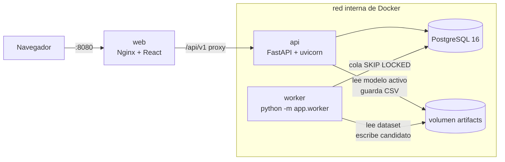
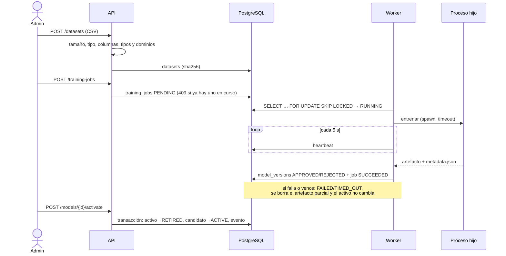

# Arquitectura

Describe el sistema **tal como está implementado**. Las decisiones y su justificación están en
[analisis-arquitectura.md](analisis-arquitectura.md).

## Vista general

Monolito modular en Python con dos procesos (API y worker), PostgreSQL y una SPA servida por Nginx.



| Servicio | Imagen | Puerto publicado | Responsabilidad |
|---|---|---|---|
| `db` | `postgres:16.6-alpine` | `127.0.0.1:5432` | Persistencia |
| `api` | `depression-risk-backend:1.0.0` | `127.0.0.1:8000` | Migraciones, datos iniciales, API REST |
| `worker` | la misma imagen | — | Re-entrenamientos asíncronos |
| `web` | `depression-risk-web:1.0.0` | `127.0.0.1:8080` | SPA y proxy hacia la API |

## Backend (`backend/src/app`)

```text
main.py          fábrica de la app FastAPI (middleware, CORS, errores, routers)
worker.py        proceso worker (señales, heartbeat)
bootstrap.py     inicialización idempotente: admin + dataset semilla + modelo v1
records.py       registra todas las tablas (lo importa todo punto de entrada)
config.py        Settings validadas al iniciar (fail fast)
api/             dependencias HTTP, permisos, formato único de error
machine_learning/ contrato del dataset, preparación, features, entrenamiento, evaluación, artefactos
shared/          base de datos, errores de aplicación, logs JSON, rate limiting
modules/
  auth/            domain (Role, Principal) · application (AuthService) · infrastructure (records, Argon2, JWT) · presentation
  prediction/      domain (RiskBand, aviso) · application (PredictionService) · infrastructure · presentation
  model_registry/  domain (estados y transiciones) · application (registro, activación, rollback, caché del modelo) · infrastructure · presentation
  datasets/        application (validación y versionado) · infrastructure · presentation
  training/        domain (JobStatus) · application (cola y worker) · infrastructure · presentation
  health/          presentation
```

**Reglas de dependencia.** `presentation → application → domain`. Los servicios de aplicación usan
los modelos ORM de su módulo directamente: se decidió no agregar una capa de repositorios porque
serían envoltorios vacíos de SQLAlchemy (KISS). `machine_learning/` es una biblioteca pura, sin FastAPI ni base
de datos, y la usan por igual el entrenamiento, el worker y la inferencia. Así el preprocesamiento
es uno solo y no hay *training/serving skew*.

### Flujo de una predicción

1. `POST /api/v1/predictions`: Pydantic valida tipos, rangos y categorías con el contrato de
   `machine_learning/schema.py`. Rechaza campos extra.
2. `PredictionService` obtiene el modelo `ACTIVE`. `ActiveModelProvider` lo tiene en memoria y lo
   recarga solo si cambió la versión activa; antes de cargarlo verifica el hash y las versiones de
   las librerías.
3. Calcula la probabilidad y la banda (bajo < 0,40 ≤ moderado < 0,70 ≤ alto) y guarda en
   `predictions` la entrada, el resultado, la probabilidad, la latencia y `model_version_id`,
   todo en la misma transacción del request.

### Flujo de re-entrenamiento



## Frontend (`frontend/src`)

```text
api/client.ts        único punto de acceso HTTP (token, errores, tipos)
api/schema.d.ts      tipos generados desde docs/openapi.json (npm run gen:api)
features/
  assessment/        formulario y resultado
  metrics/           panel con gráficas (Recharts)
  auth/              sesión, login y guardia de rutas
  history/ datasets/ training/   pantallas de administración
components/          Layout, SelectField, estados de carga/error
lib/                 formatos y validación de redirecciones
```

Los datos del servidor se manejan con TanStack Query: caché, reintentos solo para errores 5xx y
consultas periódicas mientras un re-entrenamiento está en curso. Las pantallas de métricas y de
administración se cargan bajo demanda. La interfaz muestra únicamente lo que la API confirmó.
