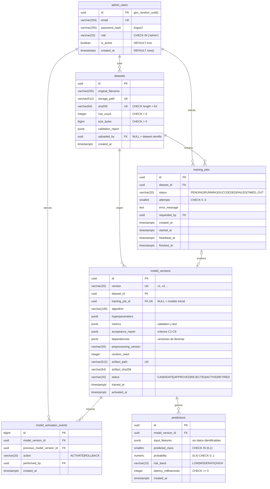

# Base de datos

PostgreSQL 16. Todo el esquema se crea con migraciones de Alembic
([backend/migrations](../backend/migrations)). El test `test_migration_matches_records`
garantiza que los modelos de SQLAlchemy (`records.py`) y las migraciones no divergen.

## Diagrama entidad-relación

El mismo diagrama, en formato DBML y con colores, está en [sql/diagrama.dbml](sql/diagrama.dbml).
Para obtener la imagen: copiar el archivo en [dbdiagram.io](https://dbdiagram.io) y usar
*Export → PNG* o *PDF*.



> El ERD también puede exportarse desde pgAdmin: Tools → ERD Tool sobre la base `depression_risk`.

## Restricciones e índices relevantes

| Objeto | Propósito |
|---|---|
| `uq_model_versions_single_active`: índice único parcial `WHERE status = 'ACTIVE'` | Nunca hay dos modelos activos |
| `uq_training_jobs_single_running`: índice único parcial `WHERE status = 'RUNNING'` | Un solo entrenamiento a la vez |
| `ix_training_jobs_status_created_at` | El worker toma el siguiente trabajo pendiente |
| `ix_predictions_created_at`, `ix_predictions_model_version_created_at` | Historial paginado y filtrado por versión |
| Todas las FK con `ON DELETE RESTRICT` | No se borra historial de forma implícita |
| CHECK de estados, rangos y longitudes de hash | La base valida aunque falle la aplicación |

## Script SQL

[docs/sql/schema.sql](sql/schema.sql) se genera desde las migraciones en modo offline, sin
conectarse a ninguna base:

```bash
cd backend
uv run alembic upgrade head --sql > ../docs/sql/schema.sql
```

## Procedimiento para generar la base

**Opción A, recomendada (Docker):** `docker compose up -d`. El servicio `api` ejecuta
`alembic upgrade head` antes de arrancar y luego `python -m app.bootstrap`, que crea el
administrador, registra el dataset semilla y entrena y activa el modelo v1.

**Opción B, un PostgreSQL propio con el script SQL:**

```bash
createdb -U postgres depression_risk
psql -U postgres -d depression_risk -f docs/sql/schema.sql
```

El script deja registrada la revisión `0001` en `alembic_version`, así que después se puede seguir
con Alembic normalmente.

**Opción C, Alembic directo:** con `POSTGRES_*` en `.env`, ejecutar `cd backend && uv run alembic upgrade head`.

## Retención y respaldo

- Las predicciones se conservan; la retención propuesta es de 180 días mediante una purga manual
  documentada, no automática.
- Respaldo: `docker compose exec db pg_dump -U $POSTGRES_USER $POSTGRES_DB > backup.sql`.
  Restauración: `psql … < backup.sql`. Los artefactos de modelos viven en el volumen `artifacts` y
  se respaldan junto con la base.
