# Estimación del riesgo de depresión en estudiantes con CRISP-ML(Q)

**Trabajo final · Taller de Sistemas de Información e IA (TALLERSISIA) · Semestre 2-2026**
Repositorio: https://github.com/shariloza/proyectoSIS

> El sistema estima un **riesgo estadístico** con fines académicos. **No es un diagnóstico.** Toda
> respuesta incluye un aviso y la recomendación de buscar apoyo profesional.

---

## 1. Resumen

Se entrenó un modelo de **clasificación binaria** que estima la probabilidad de que un estudiante
presente depresión a partir de 11 variables académicas y de hábitos. El modelo seleccionado, una
regresión logística, obtuvo en datos de prueba un **ROC-AUC de 0,870** y un **recall de 0,851**
para la clase de riesgo, y cumple los 8 criterios de aceptación definidos antes de entrenar.

El modelo se expone mediante una **API REST** (FastAPI) que permite predecir, consultar el
historial y las métricas, subir archivos de entrenamiento y re-entrenar de forma asíncrona, con
activación explícita y rollback. Un **cliente web** (React) consume todos los endpoints. Todo se
ejecuta con Docker Compose y se valida con **98 tests de backend, 11 de frontend y 8 end-to-end**.

## 2. Metodología y cronograma

Se siguió **CRISP-ML(Q)** (Cross-Industry Standard Process for Machine Learning with Quality
assurance), que agrega aseguramiento de calidad a cada fase de CRISP-DM. El desarrollo de software
se organizó en fases con una rama `feature/*` y un Pull Request por fase hacia `dev`, cada uno
revisado por CI y por IA (GitHub Copilot).

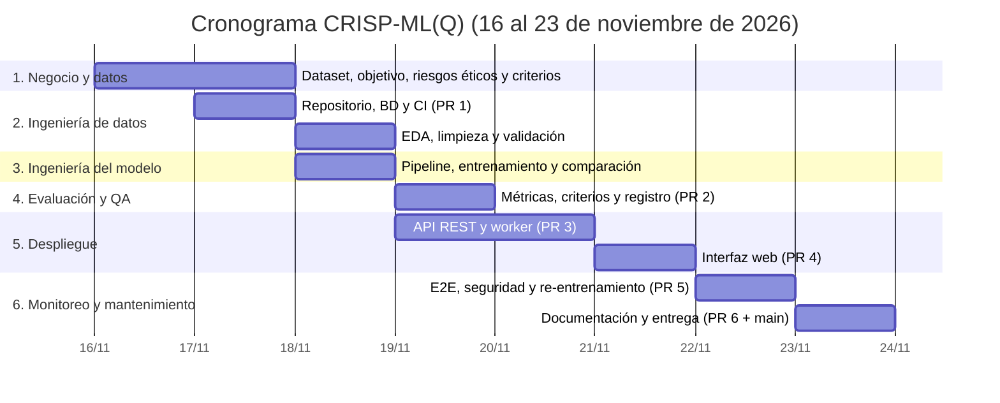

| Fase CRISP-ML(Q) | Entregable de calidad | PR |
|---|---|---|
| 1. Entendimiento del negocio y de los datos | Requisitos, riesgos éticos y criterios de aceptación **antes** de entrenar | Análisis (commit inicial) |
| 2. Ingeniería de datos | Contrato del dataset, validación fail fast y preparación documentada | PR 1 y PR 2 |
| 3. Ingeniería del modelo | Pipeline sin leakage, semilla fija y comparación con un modelo base | PR 2 |
| 4. Evaluación | Métricas por clase, equidad y criterios C1–C8 | PR 2 |
| 5. Despliegue | API, worker, cliente web y Docker | PR 3 y PR 4 |
| 6. Monitoreo y mantenimiento | Re-entrenamiento controlado (C9), rollback, E2E y seguridad | PR 3 y PR 5 |

## 3. Fase 1: entendimiento del negocio y de los datos

**Problema.** La depresión estudiantil suele detectarse tarde. Una herramienta breve y anónima
puede ayudar a un estudiante a reconocer factores de riesgo y a buscar ayuda a tiempo.

**Tipo de problema.** Clasificación supervisada binaria (`Depression` = 0/1).

**Datos.** *Student Depression Dataset* de Kaggle: 27 901 respuestas y 18 columnas. Clases:
58,6 % con depresión y 41,4 % sin depresión, un desbalance moderado que no requirió
re-muestreo.

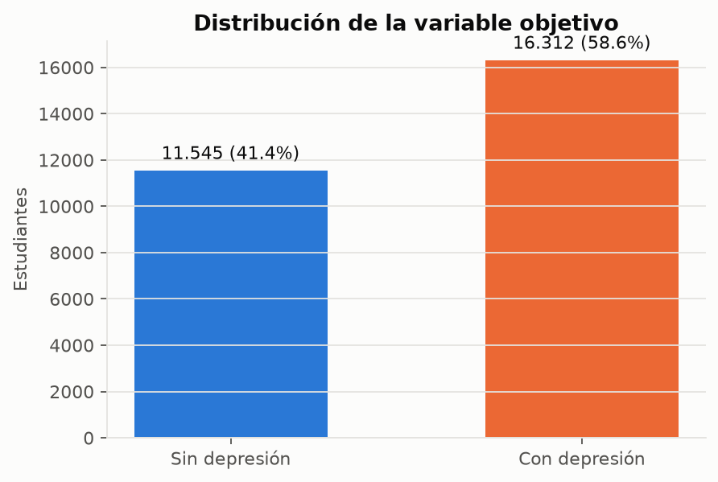

**Análisis exploratorio.** La presión académica y el estrés financiero muestran una relación
fuerte y monótona con la depresión: la tasa pasa de un 19 % con presión 1 a un 86 % con presión 5.
Dormir menos de 5 horas y una alimentación poco saludable también se asocian con más riesgo.

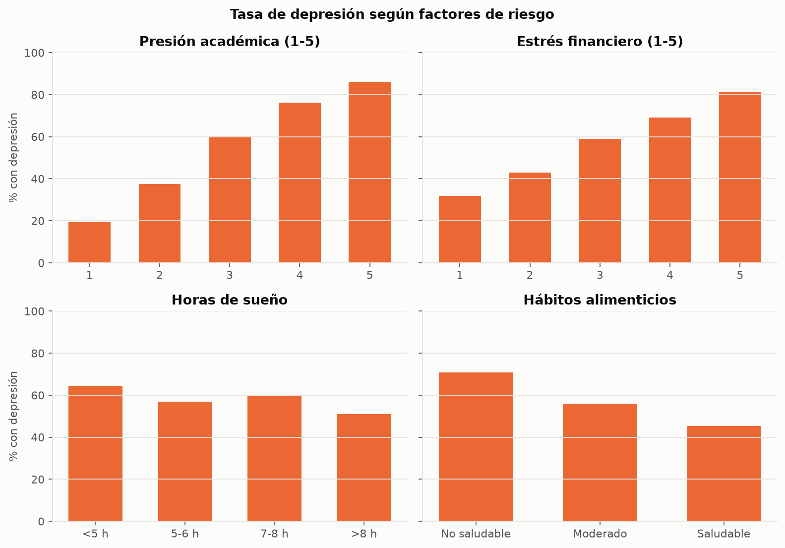

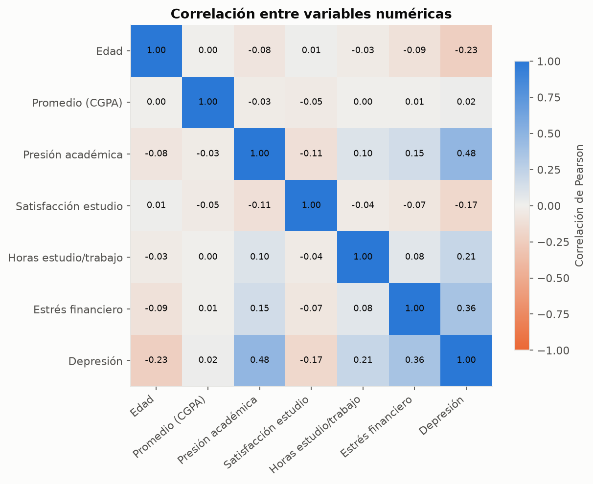

**Criterios de aceptación** (fijados antes de entrenar): ROC-AUC ≥ 0,85, recall de la clase 1
≥ 0,80 (un falso negativo cuesta más que un falso positivo), precisión ≥ 0,75, F1 macro ≥ 0,78,
mejora sobre el Dummy ≥ 0,25, brecha de recall entre géneros ≤ 0,05, diferencia entre validación
y test ≤ 0,03, latencia p95 ≤ 100 ms y, para re-entrenamientos, no empeorar al modelo activo en más
de 0,01 de ROC-AUC.

## 4. Fase 2: ingeniería de datos

Se verificaron con pandas 13 hallazgos de calidad, y cada uno tiene un tratamiento justificado:

| Hallazgo | Tratamiento |
|---|---|
| Pregunta "¿Has tenido pensamientos suicidas?": muy predictiva (79 % frente a 23 %) | **Excluida por ética** |
| `Profession`, `Work Pressure`, `Job Satisfaction`: varianza casi nula | Excluidas |
| `City`: 52 valores, unos 22 basura (nombres propios, "3.0") | Excluida |
| `Degree`: 28 títulos | Agrupados en 5 niveles educativos |
| "Others" en sueño y alimentación; 0 en escalas 1–5; CGPA = 0 | 44 filas descartadas |
| 3 nulos en estrés financiero | Imputación por mediana dentro del Pipeline |

Resultado: **27 857 filas** utilizables. Un **contrato único** (`ml/schema.py`) define columnas,
rangos y categorías, y lo usan tanto la validación del dataset como la de la API. La validación
falla rápido y reporta todos los problemas juntos (columnas faltantes, tipos, objetivo no binario,
mínimo de 500 filas y máximo de 5 % de filas fuera de dominio). Detalle en [datasets.md](datasets.md).

## 5. Fase 3: ingeniería del modelo

- Split estratificado **70 / 15 / 15** con semilla 42: 19 499 / 4 179 / 4 179.
- **Sin data leakage:** imputación, escalado y codificación viven dentro de un `Pipeline` de
  scikit-learn, se ajustan solo con train y viajan en el artefacto.
- Búsqueda de hiperparámetros con validación cruzada estratificada de 5 pliegues sobre train.

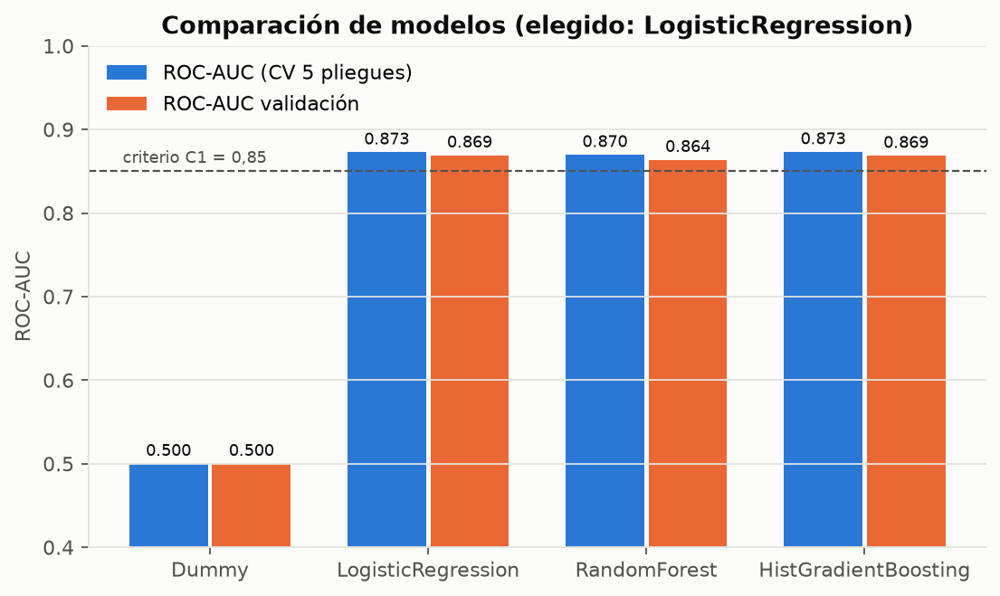

| Modelo | ROC-AUC CV | ROC-AUC validación | F1 macro validación |
|---|---|---|---|
| Dummy (base) | 0,500 | 0,500 | 0,369 |
| **Regresión logística (C = 0,1)** | 0,873 | **0,869** | 0,784 |
| Random Forest | 0,870 | 0,864 | 0,783 |
| HistGradientBoosting | 0,873 | 0,869 | 0,786 |

**Elección:** regresión logística. Empata con el boosting y, ante métricas equivalentes, se
prefiere el modelo más simple, interpretable y liviano (7 KB, 39 ms p95).

## 6. Fase 4: evaluación y aseguramiento de calidad

Resultados en el conjunto de **test**, usado una sola vez:

| Métrica | Valor |
|---|---|
| ROC-AUC | **0,870** |
| Recall clase 1 (con depresión) | **0,851** |
| Precisión clase 1 | 0,811 |
| F1 macro | 0,788 |
| Exactitud | 0,797 |

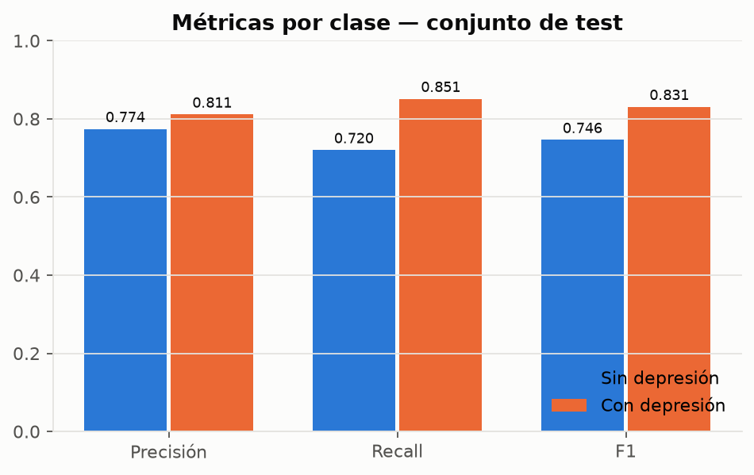

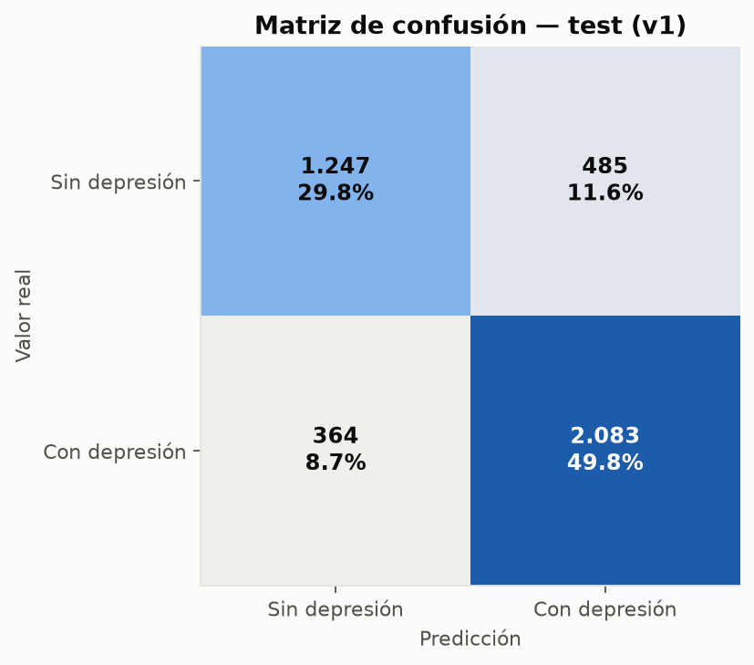 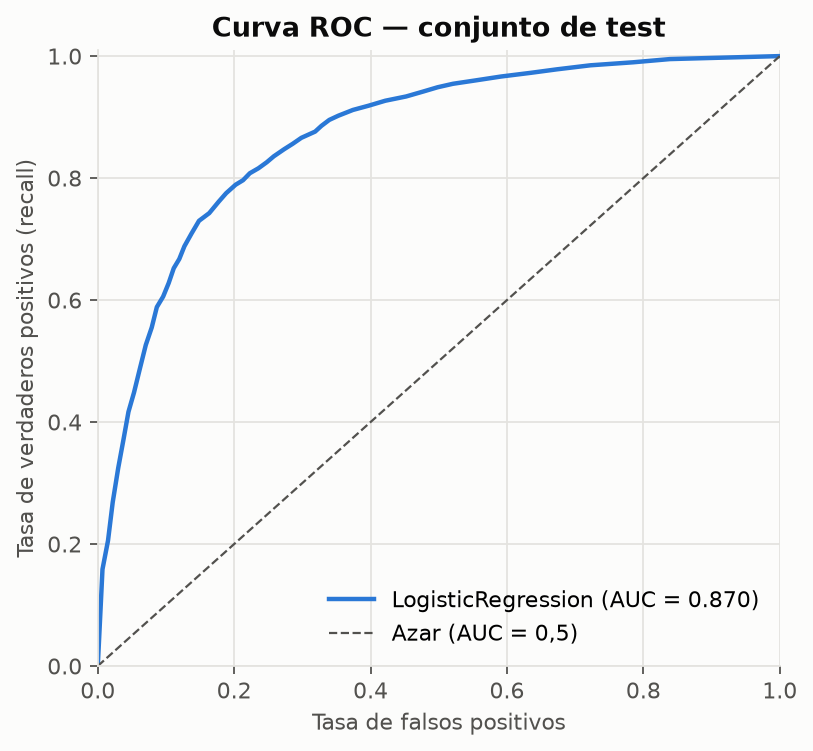

| Criterio | Umbral | Obtenido | |
|---|---|---|---|
| C1 ROC-AUC | ≥ 0,85 | 0,870 | ✅ |
| C2 Recall clase 1 | ≥ 0,80 | 0,851 | ✅ |
| C3 Precisión clase 1 | ≥ 0,75 | 0,811 | ✅ |
| C4 F1 macro | ≥ 0,78 | 0,788 | ✅ |
| C5 Mejora sobre el Dummy | ≥ 0,25 | 0,370 | ✅ |
| C6 Brecha de recall hombres/mujeres | ≤ 0,05 | 0,005 | ✅ |
| C7 Brecha validación/test | ≤ 0,03 | 0,001 | ✅ |
| C8 Latencia p95 | ≤ 100 ms | 38,9 ms | ✅ |

**Reproducibilidad:** el entrenamiento local y el realizado dentro de Docker dieron métricas
idénticas. Cada versión registra el hash del dataset, los hiperparámetros, la semilla, las
versiones de librerías y el hash del artefacto (sección 6.2 de la base).

## 7. Fase 5: despliegue (servicio y cliente web)

### 7.1 Arquitectura

**Monolito modular** en Python con dos procesos (API y worker), PostgreSQL y una SPA servida por
Nginx. Se descartaron los microservicios porque duplicaban despliegue y contratos sin beneficio
para el alcance. La cola de trabajos usa PostgreSQL (`SELECT … FOR UPDATE SKIP LOCKED`) en lugar
de Redis, porque el volumen es bajo y la tabla ya aporta trazabilidad.

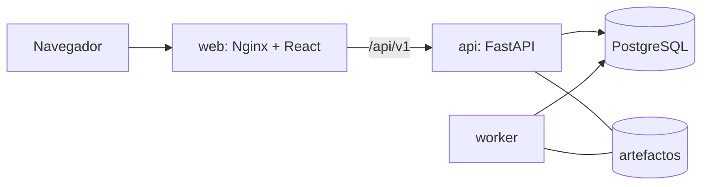

Cada módulo (`auth`, `prediction`, `model_registry`, `datasets`, `training` y `health`) se
organiza en capas de dominio, aplicación, infraestructura y presentación. Los controladores no
contienen lógica de negocio. Detalle en [arquitectura.md](arquitectura.md).

### 7.2 Base de datos

Seis tablas con claves foráneas reales, CHECK de estados y rangos, e índices únicos parciales que
garantizan **un solo modelo activo** y **un solo entrenamiento en curso**. Cada predicción queda
ligada a la versión del modelo que la produjo. El esquema se crea con migraciones de Alembic y el
script SQL se exporta en modo offline: [base-de-datos.md](base-de-datos.md) y
[sql/schema.sql](sql/schema.sql).

### 7.3 API REST

| Requisito de la materia | Endpoint |
|---|---|
| Enviar datos y obtener la predicción | `POST /api/v1/predictions` |
| Historial de predicciones (datos y resultado) | `GET /api/v1/predictions` (admin, paginado) |
| Métricas de rendimiento | `GET /api/v1/models/active` y `GET /api/v1/models` |
| Re-entrenar con información actualizada | `POST /api/v1/training-jobs` y `GET /api/v1/training-jobs/{id}` |
| Enviar el archivo de entrenamiento | `POST /api/v1/datasets` |
| Activación y rollback | `POST /api/v1/models/{id}/activate`, `POST /api/v1/models/rollback` |

El documento Swagger es [openapi.json](openapi.json), con descripciones, ejemplos y errores
documentados. Todos los errores usan un formato único con `request_id`. Hay autenticación JWT para
administración, rate limiting, CORS restrictivo y logs JSON sin datos sensibles. Detalle en
[api.md](api.md) y [seguridad.md](seguridad.md).

**Re-entrenamiento controlado:** el worker entrena en un proceso hijo con timeout y heartbeat. El
candidato queda `APPROVED` o `REJECTED` según C1–C9 y **nunca se activa solo**. Un fallo o un
timeout no afecta al modelo activo, y el rollback restaura la versión anterior. En la prueba real,
un re-entrenamiento produjo **v2 (ROC-AUC 0,876, APPROVED)** mientras v1 seguía activo hasta su
activación explícita.

### 7.4 Cliente web

React 18 + Vite + TypeScript, responsive, accesible y con modo oscuro. Un cliente HTTP
centralizado usa **tipos generados desde el contrato OpenAPI**, y el CI falla si se
desincronizan. Cada pantalla muestra estados de carga, error y éxito, y la interfaz solo refleja lo
que confirma el backend.

| Evaluación | Resultado |
|---|---|
| 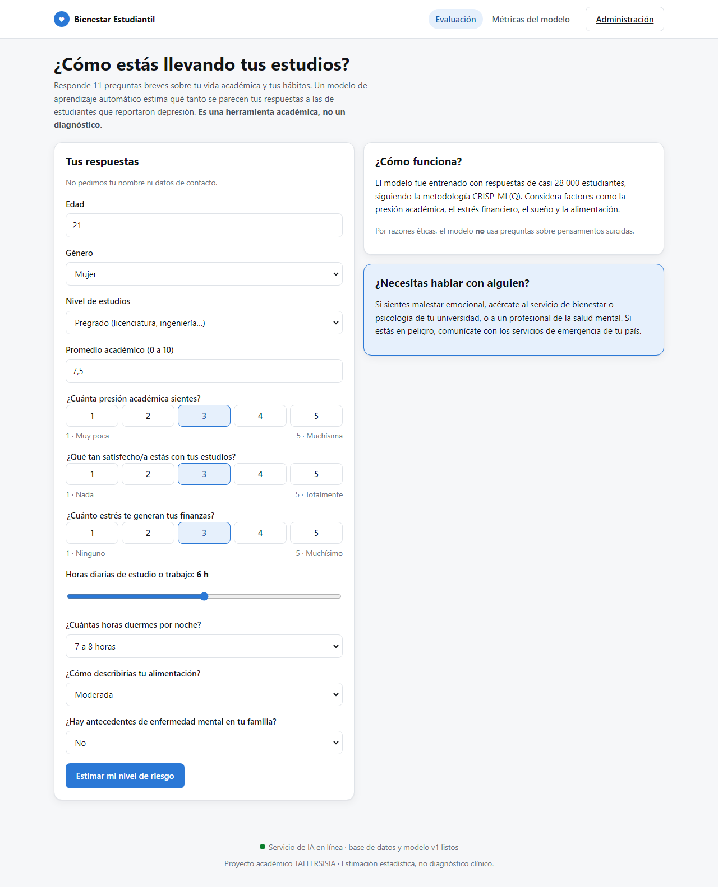 | 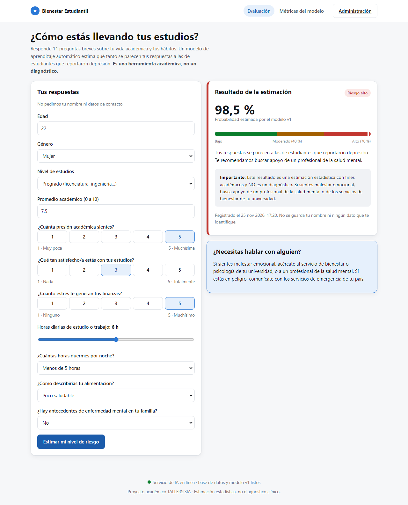 |

| Métricas del modelo | Historial (admin) |
|---|---|
| 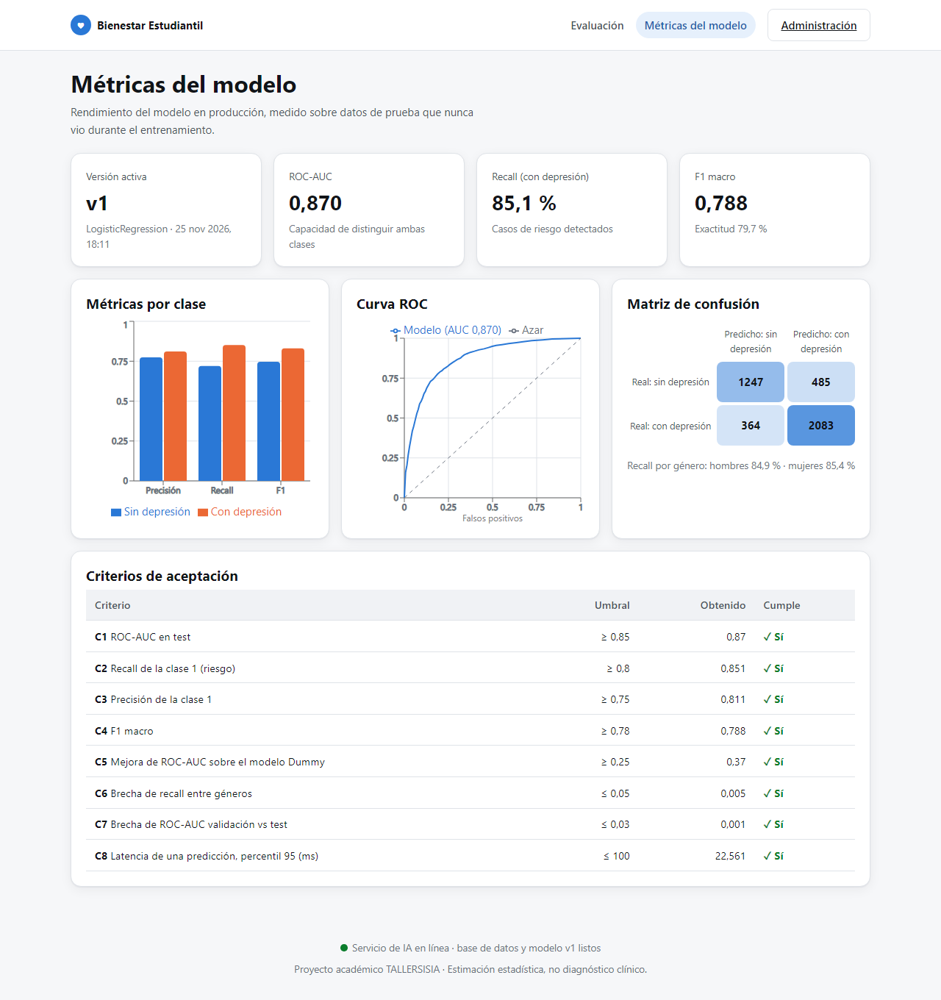 | 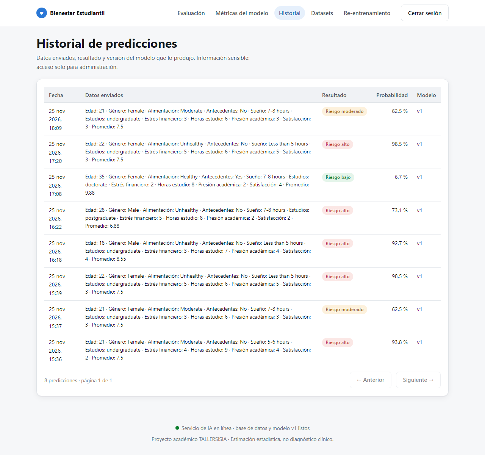 |

| Dataset rechazado | Dataset aceptado |
|---|---|
| 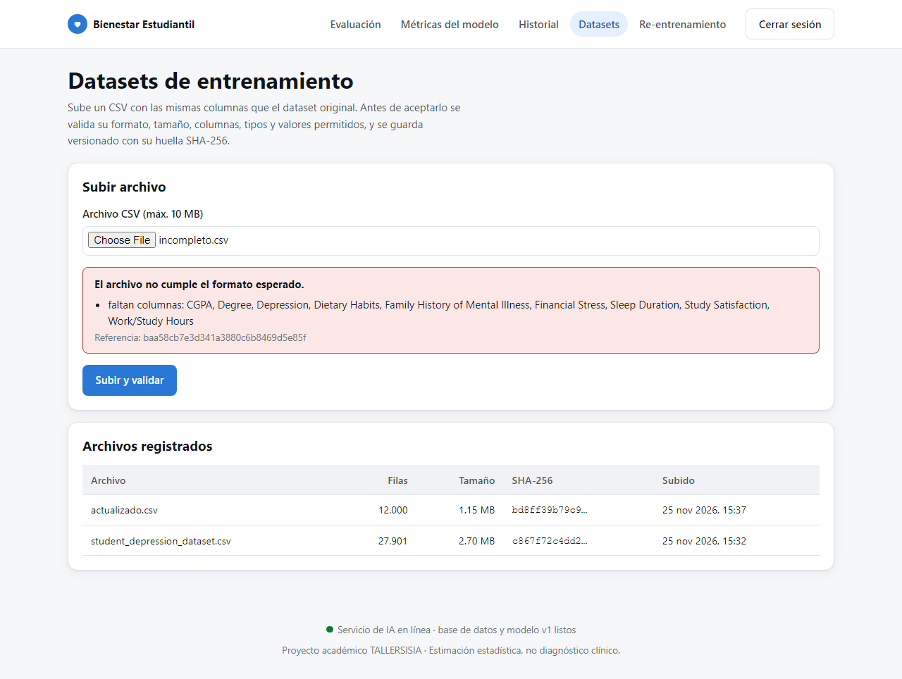 | 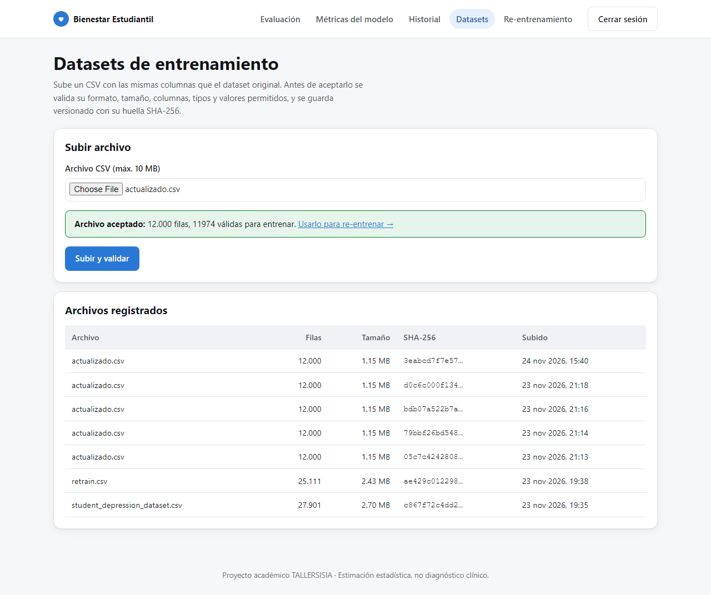 |

| Re-entrenamiento en curso | Comparación y activación | Rollback |
|---|---|---|
| 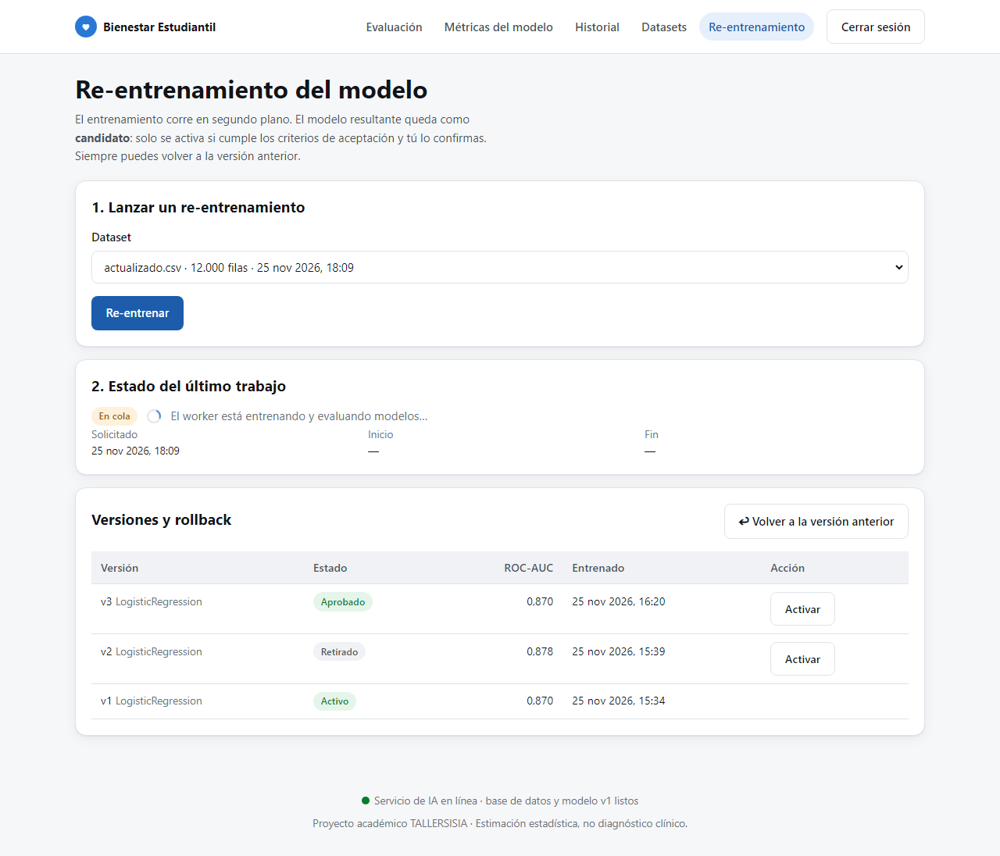 | 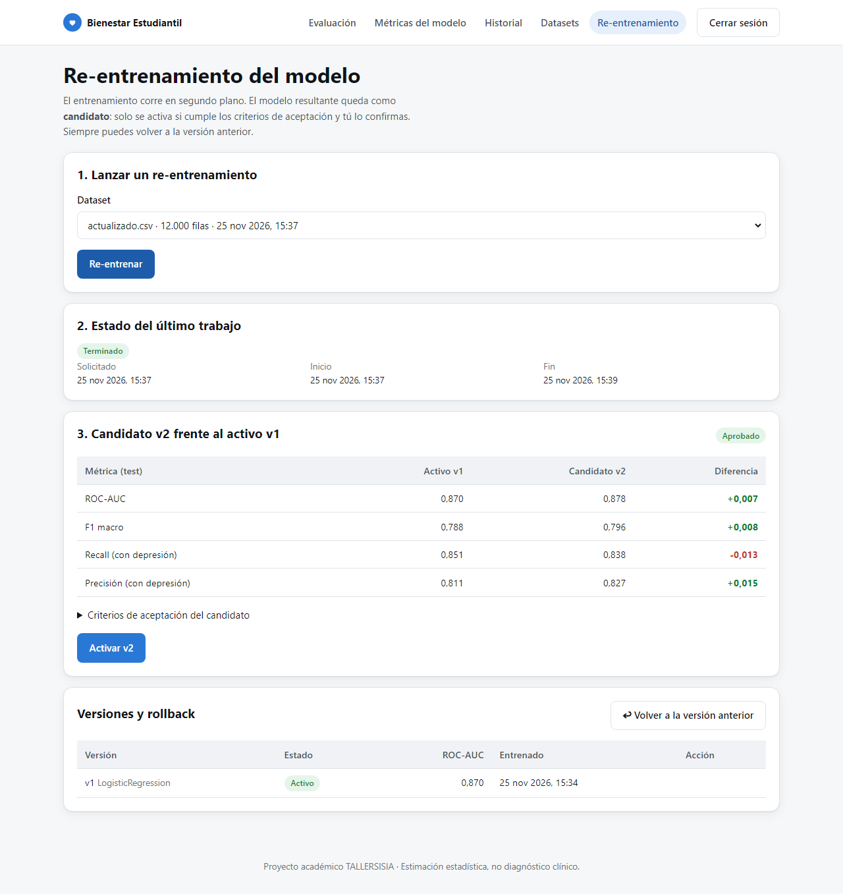 | 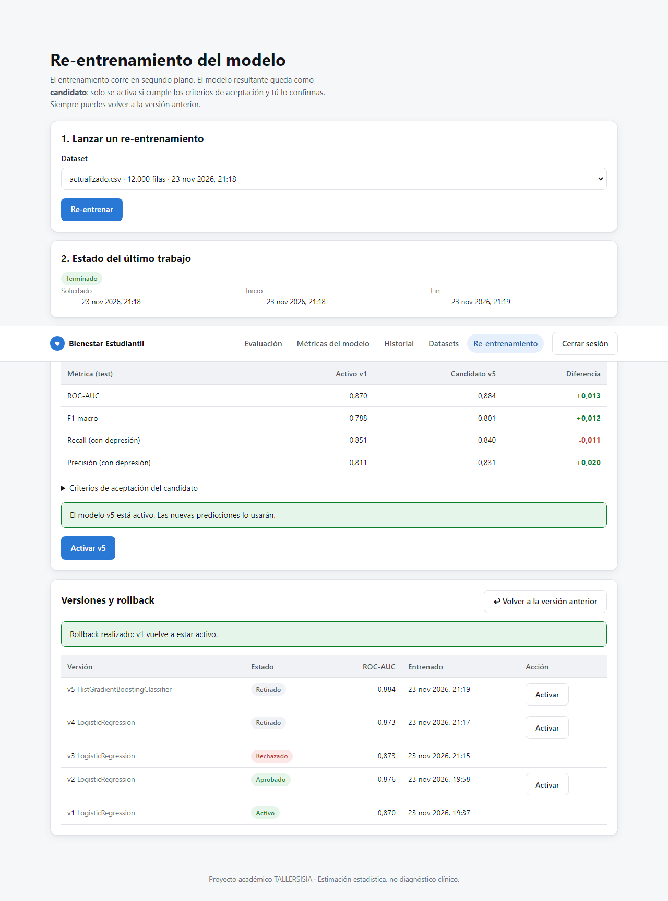 |

## 8. Fase 6: monitoreo, mantenimiento y pruebas

- **Pruebas** ([testing.md](testing.md)): 98 tests de backend (unitarios, ML, integración contra
  PostgreSQL real, API, contrato y permisos), 11 de frontend y 8 end-to-end con Playwright contra
  el sistema en Docker, incluido el ciclo subir → re-entrenar → activar → rollback.
- **CI** en cada PR: lint, tipos, tests, build y E2E.
- **Monitoreo:** readiness (base de datos y modelo), latencia y versión guardadas en cada
  predicción, y logs JSON del worker.
- **Bugs encontrados y corregidos con prueba de regresión:** el worker no registraba todas las
  tablas; la subida de archivos sin lectura acotada; un open redirect después del login; falta de
  memoria por paralelismo excesivo.

## 9. Decisiones éticas

1. Se **excluyó** la variable de pensamientos suicidas aunque mejoraba las métricas.
2. El formulario no pide datos identificables y la API rechaza campos extra.
3. El historial es de **acceso restringido**: son datos de salud mental.
4. El lenguaje de la interfaz es de "estimación", siempre con el aviso y una invitación a buscar
   apoyo, incluso con riesgo bajo.
5. Se priorizó el **recall** de la clase de riesgo y se controló la **equidad por género** (C6).

## 10. Limitaciones y trabajo futuro

- El dataset proviene de un solo país y la depresión es autoreportada: no generaliza sin datos
  locales.
- El 8,7 % del test son falsos negativos y el 11,6 % falsos positivos.
- No hay alertas automáticas de drift; el análisis se hace de forma manual sobre el historial.
- Para producción: TLS, cookie HttpOnly en lugar de `sessionStorage`, React Router 7, rate limiting
  distribuido y despliegue en Dokploy. Ver [seguridad.md](seguridad.md).

## 11. Uso de IA generativa y revisión de código

El desarrollo se hizo con asistencia de IA generativa (Claude Code), siguiendo una base de
ingeniería explícita y aprobando cada fase antes de avanzar. Cada Pull Request fue revisado
automáticamente por **GitHub Copilot** y validado por el pipeline de CI. Las capturas de esas
revisiones se adjuntan como evidencia.

## Anexos

[Análisis y arquitectura (Fase 1)](analisis-arquitectura.md) · [Arquitectura](arquitectura.md) ·
[Base de datos](base-de-datos.md) · [API](api.md) · [Seguridad](seguridad.md) ·
[Despliegue](despliegue.md) · [Testing](testing.md) · [Ciclo de vida del ML](ml-lifecycle.md) ·
[Model card](model-card.md) · [Datasets](datasets.md)
