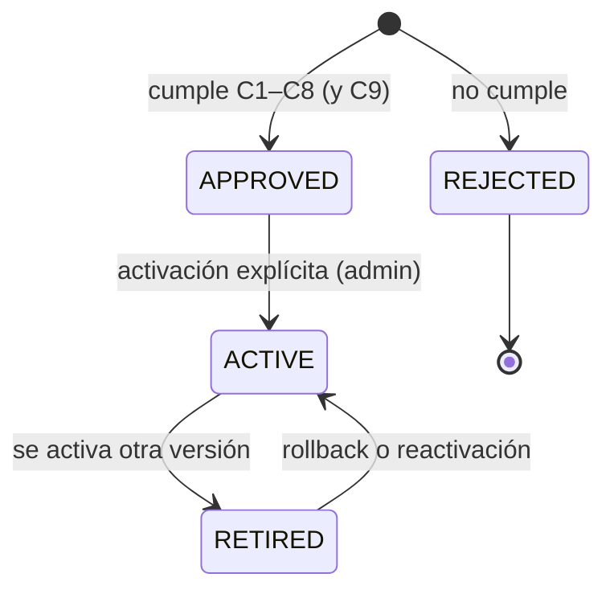

# Ciclo de vida del modelo

```text
Dataset → Validación → Preparación → Entrenamiento → Evaluación → Aprobación → Registro → Activación → Monitoreo → Re-entrenamiento
```

## 1. Validación y preparación

`ml/dataset.py` valida la estructura y falla rápido, informando todos los problemas a la vez.
Después aplica el tratamiento de [datasets.md](datasets.md) y produce un `PreparationReport`.

## 2. Entrenamiento (`ml/training.py`)

- Split estratificado **70/15/15** (train 19 499 · validación 4 179 · test 4 179), semilla **42**.
- `Pipeline(ColumnTransformer → clasificador)`: imputación por mediana y escalado (numéricas),
  codificación ordinal (sueño y alimentación), one-hot (género, antecedentes y nivel educativo).
  El preprocesamiento viaja dentro del artefacto: entrenamiento e inferencia usan el mismo código.
- `GridSearchCV` con validación cruzada estratificada de 5 pliegues sobre **train**, optimizando
  ROC-AUC.
- Candidatos: `DummyClassifier` (base), `LogisticRegression`, `RandomForestClassifier` y
  `HistGradientBoostingClassifier`.
- Selección por ROC-AUC de **validación**. Si dos modelos difieren en menos de 0,005, se elige el
  más simple. El conjunto de test se usa una sola vez, al final.

## 3. Evaluación y criterios de aceptación

Definidos en la Fase 1, **antes de entrenar** (`ml/evaluation.py`):

| | Criterio | Umbral |
|---|---|---|
| C1 | ROC-AUC (test) | ≥ 0,85 |
| C2 | Recall de la clase 1 | ≥ 0,80 |
| C3 | Precisión de la clase 1 | ≥ 0,75 |
| C4 | F1 macro | ≥ 0,78 |
| C5 | ROC-AUC del modelo menos ROC-AUC del Dummy | ≥ 0,25 |
| C6 | Brecha de recall entre géneros | ≤ 0,05 |
| C7 | Brecha de ROC-AUC entre validación y test | ≤ 0,03 |
| C8 | Latencia p95 de una predicción | ≤ 100 ms |
| C9 | (Re-entrenamiento) caída de ROC-AUC frente al activo | ≤ 0,01 |

Si todos se cumplen, el modelo queda `APPROVED`; si alguno falla, queda `REJECTED`. Ningún
modelo se activa automáticamente, salvo el v1 en la instalación inicial, si fue aprobado.

## 4. Registro (sección 6.2 de la base)

Cada versión es inmutable (`artifacts/models/<versión>/`, que nunca se sobrescribe):
`model.joblib` + `metadata.json`, con versión, fecha, hash del dataset, reporte de preparación,
algoritmo, hiperparámetros, semilla, versión del preprocesamiento, métricas de validación y test,
comparación de candidatos, criterios, versiones de Python y librerías, hash del artefacto y
estado. Lo mismo queda en la tabla `model_versions`.

Antes de cargar un artefacto se verifica su SHA-256 y que coincidan las versiones de
scikit-learn, numpy, pandas y joblib. Si no coinciden, se rechaza (`ArtifactError`).

## 5. Estados, activación y rollback



- La activación corre en una transacción: el activo pasa a `RETIRED`, el nuevo a `ACTIVE` y se
  inserta un `model_activation_events`. Un índice único parcial impide dos activos.
- El rollback reactiva el `previous_model_version_id` del último evento.
- La API detecta el cambio en la siguiente predicción y carga el nuevo artefacto sin reiniciarse.

## 6. Re-entrenamiento asíncrono

`POST /training-jobs` → fila `PENDING` → el worker la toma con `FOR UPDATE SKIP LOCKED` →
`RUNNING` → entrena en un **proceso hijo** con timeout (`TRAINING_TIMEOUT_SECONDS`) y un heartbeat
cada 5 s.

| Resultado | Estado del trabajo | Efecto |
|---|---|---|
| Entrenó y registró | `SUCCEEDED` | Nueva versión `APPROVED` o `REJECTED` |
| Excepción (por ejemplo, dataset corrupto) | `FAILED` + mensaje | Se borra el artefacto parcial; el activo no cambia |
| Superó el timeout | `TIMED_OUT` | Se termina el proceso hijo; el activo no cambia |
| El worker murió a mitad de trabajo | `TIMED_OUT` (trabajo huérfano) | Se detecta por heartbeat vencido al reiniciar |

Solo puede haber un trabajo en curso (409 en otro caso). No hay reintentos automáticos: un
administrador vuelve a encolar si lo decide. El campo `attempts` queda como trazabilidad.

## 7. Monitoreo

- `GET /health/ready`: base de datos accesible y modelo activo cargable.
- Cada predicción guarda `latency_ms`, `probability` y `model_version_id`, de modo que la
  distribución de la probabilidad y la tasa de riesgo alto pueden consultarse por versión con SQL.
- Logs JSON del worker para cada inicio, fin o fallo de entrenamiento.
- **Pendiente:** alertas automáticas de drift. Hoy el análisis es manual sobre `predictions`.

## Demostración real (Docker, 23/11/2026)

v1 activo (ROC-AUC 0,870) → se subió un dataset actualizado y se re-entrenó → **v2 `APPROVED`
(ROC-AUC 0,876)**, sin activarse solo, con v1 todavía activo → en las E2E se activó un candidato y
se volvió a v1 con rollback.
